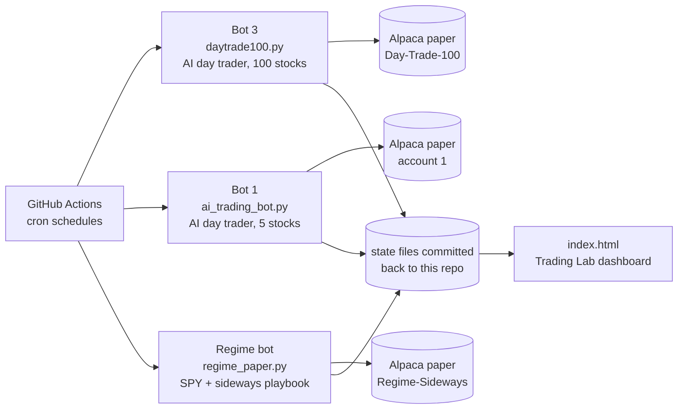

# AI Paper Trading Lab

> **Disclaimer:** Independent personal project for self-learning. Not affiliated with any employer, state agency or vendor. Paper trading only (simulated money), using public market data. No internal or confidential data and no personal data (no SSNs, PHI/PII). Educational, not investment advice.

Three automated trading bots that run on a schedule in GitHub Actions, each on its own Alpaca **paper** account. The goal is to find out, with honest measurement, whether any of them beats simply holding SPY.

- **Two AI day traders** score stocks every 10 minutes with an XGBoost + LightGBM model built on 54 features drawn from well-known traders' methods. They retrain every night and fold in the outcomes of their own trades.
- **One regime bot** holds SPY unless the market is moving sideways, then switches to a basket of oversold stocks.

Every bot saves its memory (model, logs, scorecard) back into this repository after each run, so nothing is lost between runs.

**Docs:** [Overview (PDF)](docs/Trading_Bot_Overview.pdf) · [Architecture](docs/ARCHITECTURE.md) · [Architecture (PDF)](docs/Trading_Bot_Architecture.pdf)

---

## How it works



| Bot | What it does | Runs (New York time) |
|---|---|---|
| **Bot 1** `ai_trading_bot.py` | AI day trader on a 5-stock watchlist, 15-minute bars. Signal: ML model 50%, TradingView rating 35%, RSI 15%. Closes everything by 3:50 pm | 8:30 premarket, every 10 min, 3:50 close, 12:05 am retrain |
| **Bot 3** `daytrade100.py` | Same engine on the 100 most-traded S&P 500 stocks. TradingView off; buys when the model clears its threshold and no safety veto fires | Same as bot 1; retrain 12:20 am |
| **Regime bot** `regime_paper.py` | Holds SPY in bull and bear markets. When sideways, holds 10 oversold S&P 500 stocks still above their 200-day average. Other playbooks are logged in shadow mode, never traded | Daily, 3:45 pm |
| **Backtests** `backtest_200dma.py`, `backtest_regime.py` | Test the 200-day trend and regime strategies on S&P 500 data since 2015, against SPY | By hand |

Bot 3 reuses bot 1's code: it imports `ai_trading_bot.py` and changes settings (keys, state folder, stock list) before running.

### How the AI bots learn

1. **Data:** 15-minute bars (900 days for bot 1, 365 for bot 3).
2. **Features:** 54 features covering trend, momentum, volatility, volume, time of day and SPY context. They are based on Weinstein, Minervini, O'Neil, Darvas, Tudor Jones, Raschke, Larry Williams, Bollinger and Donchian.
3. **Label:** a row counts as a buy only if price rises 0.5% within 8 bars (about 2 hours) without first dropping 1%.
4. **Real outcomes:** every closed paper trade overwrites the matching training label with what actually happened, counted 8 times.
5. **Walk-forward test:** the model is tested only on data later than what it trained on. Precision is logged after every retrain in `learning_history.json`, which is never overwritten.

### Risk rules (AI bots)

| Rule | Setting |
|---|---|
| Risk per trade | 2% of equity |
| Position size cap | 12% of equity (6% in a bear market) |
| Max open positions | 5 |
| Stop loss | -2% |
| Profit locks | breakeven once up +1.5%; +2% floor once up +4% |
| Trailing stop | starts at +6%, trails 5% below the peak, never below +3% |
| Market regime | SPY below its 50-day average: smaller positions, higher confidence needed |
| VIX | 25 or more: half size; 30 or more: no new buys |
| Earnings | no buys within 2 days of an earnings report |
| End of day | everything closed at 3:50 pm; no overnight holds |

---

## Results so far

| What | Result |
|---|---|
| Live paper trading (since October 18, 2026) | The AI bots have placed **no orders yet**. The regime bot holds SPY (bull market) and is level with SPY so far |
| Model quality, bot 1 | Walk-forward precision 31-37%, when about 26% of setups are good anyway: a small edge over guessing |
| Model quality, bot 3 | Walk-forward precision 29% against a 24% base rate |
| 200-day trend backtest (6,245 trades, 2015-2026) | +0.13% average excess over SPY per trade; beat SPY on 41% of trades. **No real edge** |
| Regime backtest v3 (2015-2026) | +15.9% a year vs SPY's +13.7%; Sharpe 0.89 vs 0.82; worst drop -36.2% vs -33.7%. An upper bound, since 22% of past S&P 500 stocks lack price data |

The model's edge is small and unproven, and there is no live track record yet. The next real test is one month of paper results against SPY. The full list of problems found and fixed is in the [overview](docs/Trading_Bot_Overview.pdf).

---

## Setup

1. **Alpaca paper accounts** (free, simulated money): create one paper account per bot at [alpaca.markets](https://alpaca.markets) and generate API keys for each.
2. **GitHub secrets:** in this repo, go to Settings, then Secrets and variables, then Actions, and add:

| Secret | Used by |
|---|---|
| `ALPACA_API_KEY`, `ALPACA_SECRET_KEY` | Bot 1 |
| `DAYTRADE100_ALPACA_API_KEY`, `DAYTRADE100_ALPACA_SECRET_KEY` | Bot 3 |
| `REGIME_ALPACA_API_KEY`, `REGIME_ALPACA_SECRET_KEY` | Regime bot |
| `TELEGRAM_BOT_TOKEN`, `TELEGRAM_CHAT_ID` | Optional trade alerts for bot 1 |

3. **Schedules** run on their own once the workflows are enabled. Any bot can also be run by hand from the Actions tab with a chosen mode (`premarket`, `scan`, `eod` or `retrain`).

Notes:
- Schedule times are in UTC and set for daylight time. Move them one hour later when daylight saving ends.
- The Gemini news briefing is optional and needs a `GEMINI_API_KEY`. Without it, bot 1 trades its fallback watchlist (NVDA, PANW, AVGO, SOFI, PLTR).
- Never put API keys in the code. The regime bot is hard-coded to Alpaca's paper endpoint.

To run locally: `pip install -r requirements.txt`, set the same keys as environment variables, then `python ai_trading_bot.py --mode scan`.

---

## Files

```
ai_trading_bot.py      Bot 1: the AI day trader (signal engine, model, risk rules)
daytrade100.py         Bot 3: bot 1's engine on 100 stocks, its own account
regime_paper.py        Regime bot: SPY or the sideways playbook
apply_updates.py       Run before bot 1: one-job-per-run mode, saved state, VIX gate
backtest_200dma.py     200-day trend backtest vs SPY
backtest_regime.py     Regime strategy backtest (v3)
index.html             Trading Lab dashboard; reads the state files from this repo
state/                 Bot 1, regime bot and backtest memory and results
state_dt100/           Bot 3 memory and scorecard
docs/                  Overview and architecture
.github/workflows/     The schedules
render.yaml            Old Render setup, no longer used
```

---

## Stack

Python 3.11 · Alpaca (paper trading, market data, news) · XGBoost + LightGBM · scikit-learn · TradingView ratings · Yahoo Finance · SEC EDGAR · Google Gemini (optional) · GitHub Actions · Telegram (optional)

---

*Independent personal project. Paper trading only, public market data only, no employer or personal data of any kind. Past or backtested performance does not guarantee future results. Not investment advice.*
