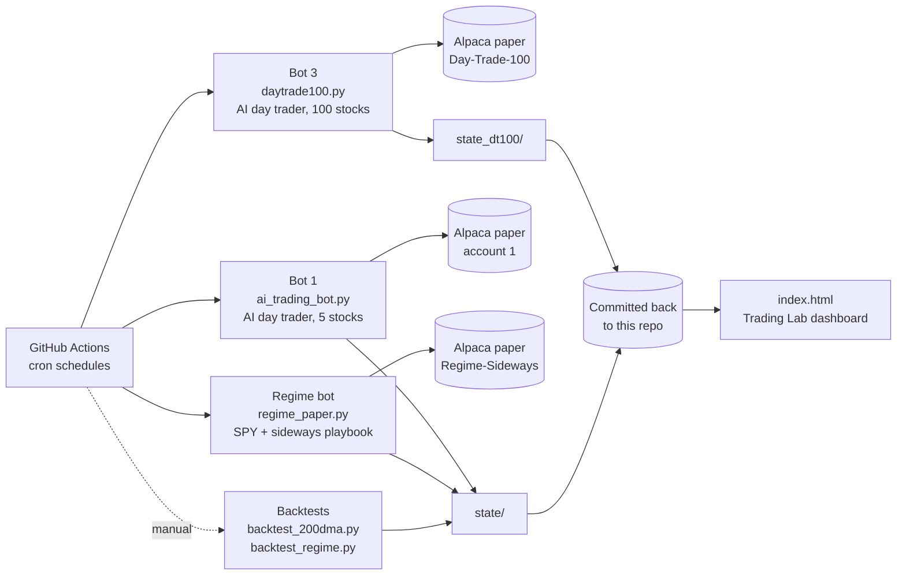
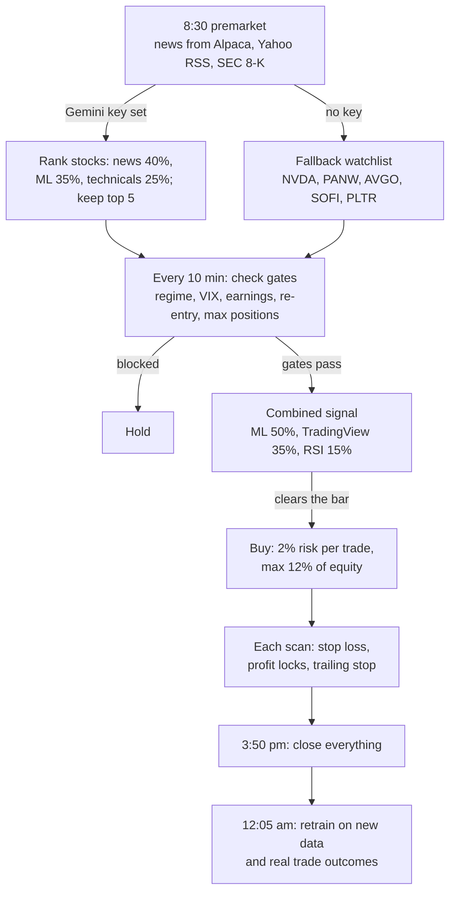
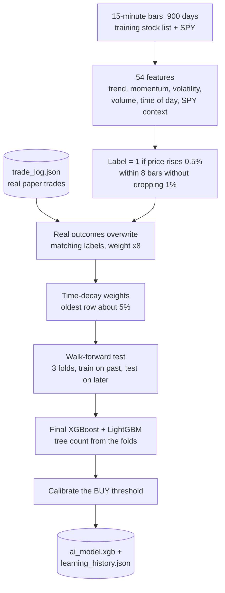
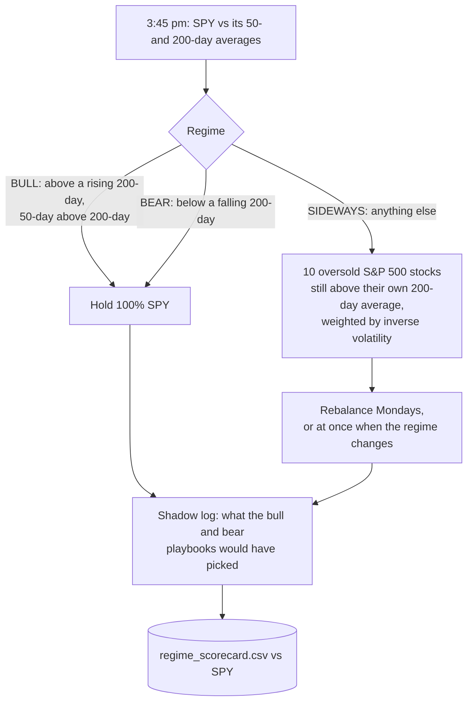

# Architecture: AI Paper Trading Lab

> **Disclaimer:** Independent personal project for self-learning. Not affiliated with any employer, state agency or vendor. Paper trading only (simulated money), using public market data. No internal or confidential data and no personal data (no SSNs, PHI/PII). Educational, not investment advice.

Author: Shubham Singh | Last updated: October 2026 | Status: three bots running on paper accounts, no live track record yet

This document describes how the system is built today, from the code. Results, problems found and the honest assessment are in [Trading_Bot_Overview.pdf](Trading_Bot_Overview.pdf). A PDF of this document: [Trading_Bot_Architecture.pdf](Trading_Bot_Architecture.pdf).

---

## 1. System overview

Three bots run on a schedule in GitHub Actions (free). Each has its own Alpaca **paper** account, and each saves its memory (model, logs, scorecard) back into this repository after every run, so nothing is lost between runs. A static dashboard reads those files.

| Bot | File | Account | What it trades | Schedule (New York time) |
|---|---|---|---|---|
| Bot 1 | `ai_trading_bot.py` | Paper account 1 | 5-stock watchlist, intraday, 15-minute bars | 8:30 premarket, every 10 min 9:00-3:50, 3:50 close all, 12:05 am retrain |
| Bot 3 | `daytrade100.py` | Paper "Day-Trade-100" | 100 most-traded S&P 500 stocks, intraday | Same as bot 1; retrain 12:20 am |
| Regime bot | `regime_paper.py` | Paper "Regime-Sideways" ($25,000) | SPY, or 10 S&P 500 stocks when the market is sideways | Once a day, 3:45 pm |
| Backtests | `backtest_200dma.py`, `backtest_regime.py` | none | Historical daily data since 2015 | Run by hand |

Bot 3 reuses bot 1's code: it imports `ai_trading_bot.py` and changes settings before it runs (its own keys, state folder, stock list, shorter training window, simpler buy rule). Bot 1's code is not modified by it.

Cron times are in UTC and set for daylight time; they need one hour added after daylight saving ends.

---

## 2. Bot 1: the AI day trader

### Daily cycle

Each GitHub Actions run does one job (`--mode premarket | scan | eod | retrain`) and exits. `runtime_state.json` carries the watchlist, peak prices, re-entry watch list and earnings dates from one run to the next.

Note: GitHub Actions does not pass a Gemini key, so in practice bot 1 trades the fallback five stocks every day.

### Signal engine

| Input | Weight | Notes |
|---|---|---|
| ML ensemble (XGBoost + LightGBM) | 50% | Probability that the stock makes a clean move up in the next ~2 hours |
| TradingView 15-minute rating | 35% | When TradingView is neutral or unavailable, its weight moves to the ML score and the bar drops from 0.55 to 0.48 |
| RSI quality filter | 15% | Penalizes overbought and oversold extremes |

The ML probability must also clear a decision threshold that is recalibrated at every retrain (0.62 normally, 0.68 in a bear regime).

### Risk rules (as set in the code)

| Rule | Setting |
|---|---|
| Risk per trade | 2% of equity |
| Position size cap | 12% of equity (6% in a bear regime) |
| Max open positions | 5 |
| Stop loss | -2% |
| Breakeven lock | stop moves to entry once up +1.5% |
| Profit lock | +2% floor once up +4% |
| Trailing stop | starts at +6%, trails 5% below the peak, never below +3% |
| Re-entry after an exit | waits for reversal signals (2 after a stop loss, 1 after a profit), minimum 5 min, maximum 4 hours |
| Market regime | SPY below its 50-day average = bear: smaller positions, higher confidence required |
| VIX | 25 or above: half size; 30 or above: no new buys |
| Earnings | no buys within 2 days of an earnings report |
| End of day | everything closed at 3:50 pm; no overnight holds |

### How the model learns

- **Features** encode ideas from well-known traders (Weinstein stage analysis, Minervini trend template, O'Neil volume, Darvas boxes, Tudor Jones 200-day trend, Raschke, Larry Williams, Bollinger, Donchian), plus time-of-day and market context.
- **Walk-forward precision** is the honest metric: the model is tested only on data later than what it trained on. It is logged after every retrain in `learning_history.json`, which is never overwritten.
- **Real outcomes:** every closed paper trade overwrites the label of the matching training row and counts 8 times, so the model sees its own mistakes.

---

## 3. Bot 3: Day-Trade-100

Same engine as bot 1, with these changes (all in `daytrade100.py`):

| Change | Why |
|---|---|
| 100 most-traded S&P 500 stocks for training and trading | Test the model on a wide, liquid universe instead of 5 hand-picked names |
| TradingView off | 100 calls every 10 minutes would be rate-limited |
| News re-ranking off | Always scan all 100 |
| 365-day training window | 900 days x 100 stocks is too heavy for a free GitHub runner |
| Time-decay rate 3/700,000 | The original rate overflowed to infinity with ~650,000 rows |
| Buy rule: model confidence clears the threshold and no veto fires | Vetoes: RSI above 78, price below the 50-period EMA, price at the top of its Bollinger Band |
| Daily scorecard vs SPY | `state_dt100/scorecard.csv` |

---

## 4. Regime bot

A daily, slower strategy, built from the regime backtest (version 3).

The paper account trades only the sideways playbook. The other playbooks run in shadow mode, recorded but never traded, so they can be re-evaluated later without risk. The account URL is hard-coded to Alpaca's paper endpoint.

---

## 5. Backtests

| Backtest | Rules | Universe | Bias controls |
|---|---|---|---|
| `backtest_200dma.py` | Buy above a rising 200-day average after a strong 3-month run that has cooled off; exit on a 3% break below the average or after 63 days; next-day fills, 0.05% cost per side | All current S&P 500 stocks since 2015 | Each trade compared with SPY over the same dates. Uses today's members, so some survivorship bias remains |
| `backtest_regime.py` (v3) | The regime bot's rules | Point-in-time S&P 500 membership since 2015 | Stocks delisted from Yahoo are missing (78% coverage), so results are an upper bound |

---

## 6. State and files

| Path | Written by | What it holds |
|---|---|---|
| `state/ai_model.xgb`, `state/learning_history.json` | Bot 1 | Model and one row per retrain (accuracy, precision, walk-forward precision, threshold, trades folded in) |
| `state/runtime_state.json`, `state/ai_bot.log` | Bot 1 | Carry-over between runs; activity log |
| `state/regime_*` | Regime bot, regime backtest | Paper state, daily scorecard, shadow log, backtest series |
| `state/backtest_*` | Backtests | Output and per-trade results |
| `state_dt100/` | Bot 3 | Its own model, learning history, log, runtime state and scorecard |
| `apply_updates.py` | Workflow, before bot 1 runs | Patches bot 1 for one-job-per-run mode, runtime state and the VIX gate; does nothing if already patched |
| `index.html` | You | Trading Lab dashboard; reads the state files from this repo |
| `render.yaml` | - | Old Render setup, no longer used |

---

## 7. Stack

| Part | Choice |
|---|---|
| Broker and market data | Alpaca (paper accounts), Alpaca News |
| Other data | Yahoo Finance (daily prices, VIX, RSS), SEC EDGAR 8-K feed, TradingView ratings |
| Models | XGBoost + LightGBM ensemble, scikit-learn metrics |
| Optional language model | Google Gemini (news briefing; skipped when no key is set) |
| Hosting | GitHub Actions on a schedule (moved from Render) |
| Alerts | Telegram (optional) |
| Language | Python 3.11 |

---

*Independent personal project. Paper trading only, public market data only, no employer or personal data of any kind. Not investment advice.*
